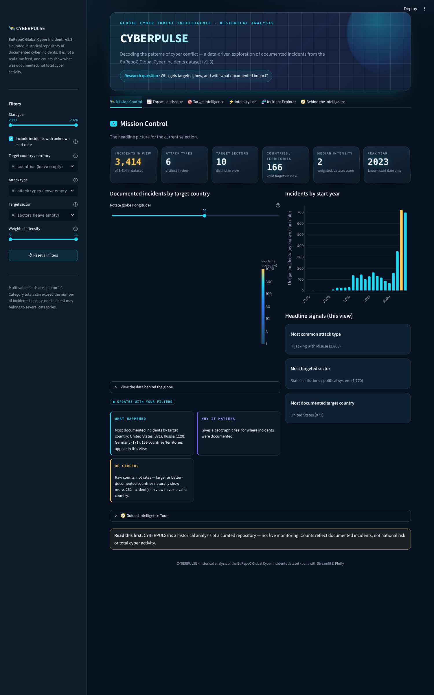
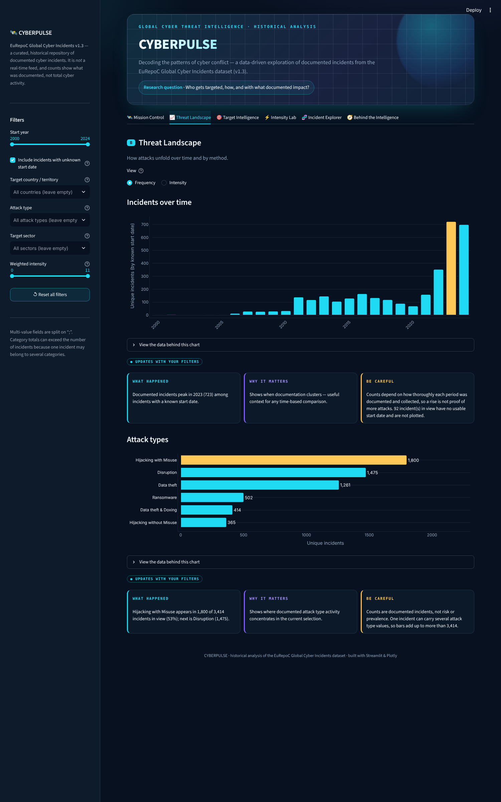
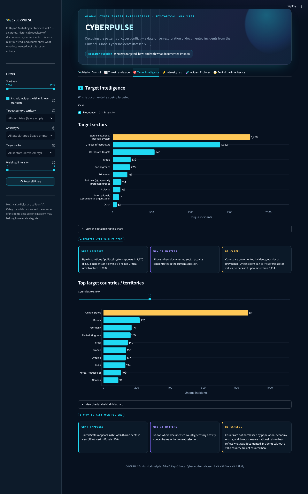
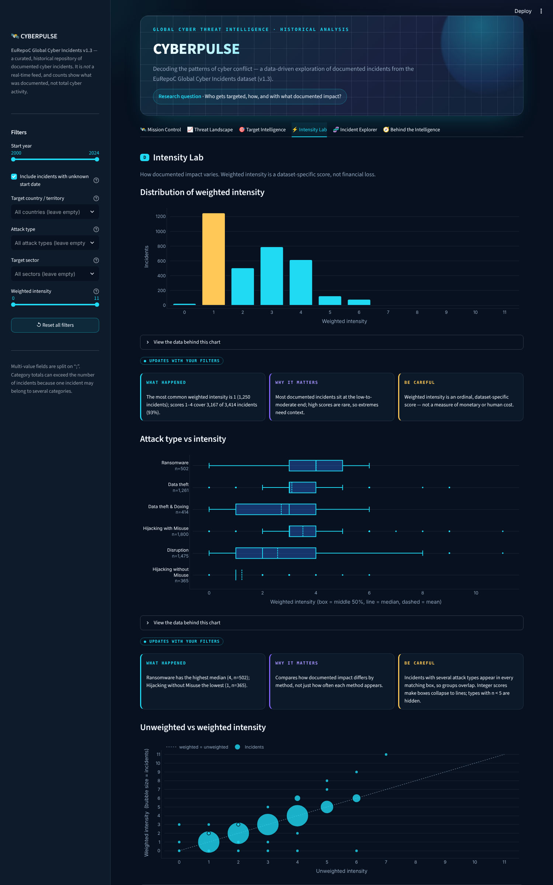
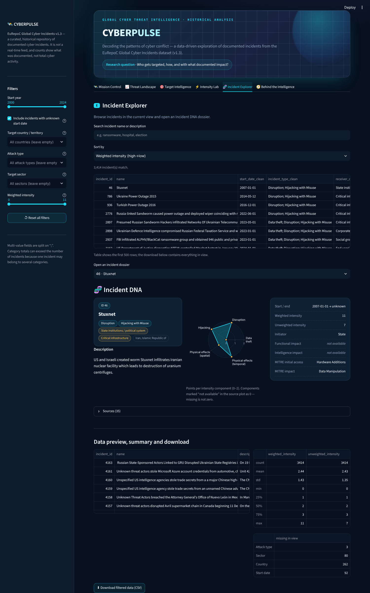
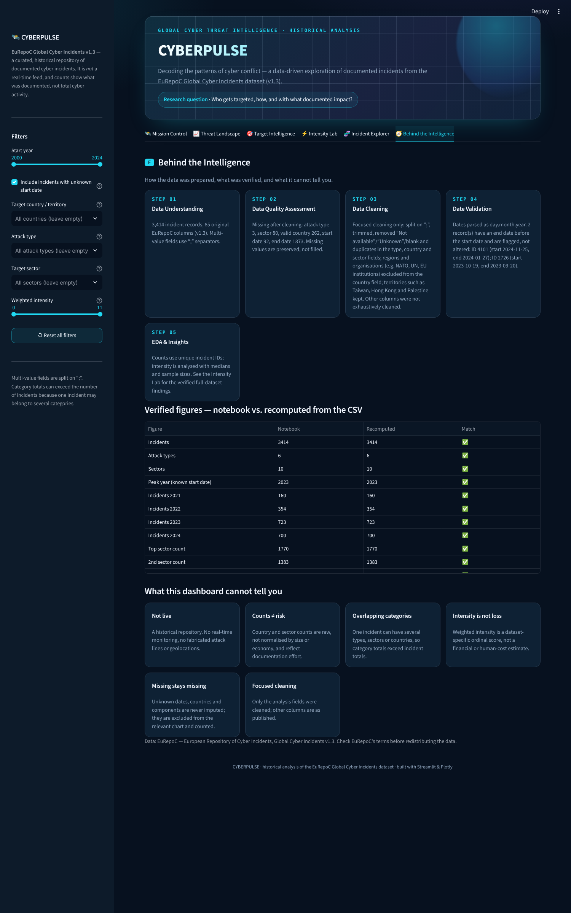

# 🛰️ CYBERPULSE — Global Cyber Threat Intelligence
**Decoding the patterns of cyber conflict.** An interactive Streamlit dashboard built on the
cleaned **EuRepoC Global Cyber Incidents v1.3** dataset (3,414 incidents).

> **Research question:** *Who gets targeted, how, and with what documented impact?*

This is a **historical analysis** of a curated repository — not live monitoring. Nothing is simulated or imputed.

## Screenshots
| Mission Control | Threat Landscape |
|---|---|
|  |  |
| **Target Intelligence** | **Intensity Lab** |
|  |  |
| **Incident Explorer** | **Behind the Intelligence** |
|  |  |

## Features
- **A · Mission Control** – animated KPI cards, rotatable orthographic globe (incidents by target country, log colour scale), year chart, headline signals, Guided Intelligence Tour.
- **B · Threat Landscape** – incidents over time and attack types, with a **Frequency ⇄ Intensity** toggle.
- **C · Target Intelligence** – sectors and top countries/territories (Frequency or Intensity).
- **D · Intensity Lab** – intensity distribution, attack-type box plot, unweighted-vs-weighted bubble scatter, sector × attack-type median heatmap with sample counts and an adjustable minimum-n.
- **E · Incident Explorer** – search/sort, **Incident DNA** dossier (radar of intensity components, key facts, sources), data preview, summary stats, missing-value counts, CSV download of the filtered data.
- **F · Behind the Intelligence** – the 5-step data journey, a live table that re-computes every verified notebook figure from the CSV (all ✅), and the limits of the data.
- **Sidebar** – year range, country/territory, attack type, sector, weighted-intensity range, reset button.
- Every chart has a **What happened / Why it matters / Be careful** panel, tagged either *updates with your filters* or *full-dataset finding*, and a "view the data" table.
- Empty-filter handling, `st.cache_data`, reduced-motion support, no API keys.

## Data-integrity rules
- Multi-value fields (`;`-separated) are filtered by **split membership**, never substring; counts use **unique `incident_id`**.
- Category totals can exceed incident totals (one incident → several types/sectors/countries).
- Missing values stay missing (92 unknown start dates, 262 without a valid country, 80 without a sector, 3 without an attack type). Unknown-date incidents are included by default; untick the sidebar box to exclude them.
- The 2 inconsistent date records (IDs 4101, 2726: end date before start date) are flagged, not altered.
- Weighted intensity is a dataset-specific ordinal score, **not** a financial-loss metric. Counts are not risk and are not normalised.
- Only focused cleaning was performed on the type, country, sector and date fields.

## Validation against the notebook
Open **Behind the Intelligence** — 17 figures (3,414 incidents; 6 attack types; 10 sectors; peak year 2023; 160/354/723/700 incidents in 2021–2024; sector, attack-type and country counts; intensity mode 1 with 1,250 incidents; 3,167 incidents at intensity 1–4; max 11; 2 date errors) are recomputed from the CSV and compared with the notebook. Filter logic was also cross-checked against an independent split-membership count (e.g. Ransomware = 502).

## Run locally (macOS)
```bash
cd CYBERPULSE
python3 -m venv .venv && source .venv/bin/activate
pip install -r requirements.txt
streamlit run app.py
```
Open http://localhost:8501. The globe loads its map geometry from Plotly's CDN, so it needs an internet connection.

## Deploy on Streamlit Community Cloud
1. Push the `CYBERPULSE` folder (with `app.py`, `components/`, `eurepoc_cleaned.csv`, `requirements.txt`, `.streamlit/`) to a GitHub repository.
2. Go to <https://share.streamlit.io>, sign in with GitHub, click **New app**.
3. Choose the repository and branch, set **Main file path** to `app.py` (adjust if the app is in a subfolder), then **Deploy**.

## Structure
```
CYBERPULSE/
├── app.py                 # layout, tabs, wiring
├── eurepoc_cleaned.csv    # cleaned dataset from the notebook
├── requirements.txt
├── .streamlit/config.toml # dark theme
├── components/
│   ├── data.py            # loading, date parsing, split/explode helpers, ISO codes
│   ├── filters.py         # sidebar + split-membership filtering
│   ├── charts.py          # Plotly charts (return figure + data table)
│   ├── insights.py        # live and full-dataset insight text
│   └── styles.py          # CSS, KPI cards, insight panels
└── assets/                # screenshots
```

## Design rationale
Palette: `#07111F` background, `#0D1B2A`/`#12283D` surfaces, cyan `#20D9F3` primary, blue `#3478F6`, violet `#8265FF`, amber `#FFC857` reserved for the highlighted/peak value. Depth comes from perspective-tilted KPI cards, glass panels, an orthographic globe and a radar dossier; motion is subtle and switched off under `prefers-reduced-motion`. Charts use one hue per chart with amber for the single point of emphasis, thin rounded bars, recessive grids and sample sizes shown wherever medians appear.

## Data source
EuRepoC — European Repository of Cyber Incidents, *Global Cyber Incidents* v1.3. Please check EuRepoC's terms before redistributing the data.
